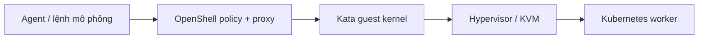

# OpenShell Lab — Kata + policy cho AI agent

Lab Kubernetes thường, gồm 6 bước và thí nghiệm A–D: cài Kata, xác nhận kernel
riêng, đo thời gian khởi động, rồi thêm OpenShell và kiểm tra egress.
**Trạng thái: chỉ soạn mã/tài liệu, chưa cài, chưa chạy lab, chưa có số liệu đo.**

Kata tách kernel workload khỏi host bằng VM. OpenShell áp policy cho hoạt động
của agent: filesystem, process và network. Kata không tự chặn HTTP gửi dữ liệu;
policy trong shared kernel không thay thế được VM boundary. Ghép hai lớp giúp
thu hẹp cả hai nhóm rủi ro, nhưng vẫn phụ thuộc cấu hình và phiên bản.



## Chuẩn bị

- Một cluster lab riêng, Kubernetes + containerd; một worker Linux x86_64 có
  `/dev/kvm`, VT-x/AMD-V hoặc nested virtualization thực sự hoạt động.
- `kubectl`, Helm 3, curl, Python 3; quyền quản trị để cài Kata và chart.
- Dự trù worker 4 vCPU / 8 GiB RAM cho lab nhỏ; đây là ngân sách dự kiến,
  không phải số đo hay minimum chính thức.
- StorageClass mặc định cho workspace PVC OpenShell; CNI hỗ trợ NetworkPolicy.
- Cluster mặc định dùng runc. Nếu mặc định là sandbox runtime khác thì baseline
  không còn là đối chứng runc; xác nhận cấu hình containerd trước khi so sánh.

Phiên bản mục tiêu: Kata **3.15.0**, OpenShell CLI/chart **0.0.116**.
Các phiên bản này chưa được chạy cùng nhau trong repo. Cần xác nhận guest kernel
hỗ trợ tính năng OpenShell ở bước 6. Image workload Alpine ghim 3.21.3;
image sandbox mặc định của chart còn dùng tag mutable, ghi digest trước khi đo.

## 1. Cài Kata theo hướng dẫn microVM trên Kubernetes

Đọc [bài Kata chính](https://katacontainers.io/blog/deploying-microvm-on-top-of-kubernetes/).
Bài 2023 dùng `main` và tên file cũ `kata-deploy-stable.yaml`; bản ghim dưới dùng
`kata-deploy.yaml`. Chỉ cài lên worker lab đã chọn. Kata deploy có đặc quyền và
thay đổi runtime của worker; đọc manifest trước khi apply.

Trên worker: kiểm tra `ls -l /dev/kvm` và `lsmod | grep kvm`. Trên máy quản trị:

```bash
export LAB_NODE=your-worker-name
kubectl label node "$LAB_NODE" sandbox-lab/worker=true
export KATA_BASE=https://raw.githubusercontent.com/kata-containers/kata-containers/3.15.0/tools/packaging/kata-deploy
curl -fL "$KATA_BASE/kata-rbac/base/kata-rbac.yaml" -o evidence/kata-rbac.yaml
curl -fL "$KATA_BASE/kata-deploy/base/kata-deploy.yaml" -o evidence/kata-deploy.yaml
# Upstream manifest dùng image :latest; thay bằng cùng release.
sed -i 's|quay.io/kata-containers/kata-deploy:latest|quay.io/kata-containers/kata-deploy:3.15.0|' evidence/kata-deploy.yaml
kubectl apply -f evidence/kata-rbac.yaml
kubectl patch --local -f evidence/kata-deploy.yaml --type merge \
  -p '{"spec":{"template":{"spec":{"nodeSelector":{"sandbox-lab/worker":"true"}}}}}' \
  -o yaml > evidence/kata-deploy-scoped.yaml
kubectl apply -f evidence/kata-deploy-scoped.yaml
kubectl -n kube-system rollout status daemonset/kata-deploy --timeout=10m
kubectl apply -f "$KATA_BASE/runtimeclasses/kata-runtimeClasses.yaml"
kubectl get runtimeclass kata-qemu
```

`kata-qemu` được chọn nhất quán trong lab. RuntimeClass phải trỏ tới handler đã
được cài trên worker; nó không tự cài Kata. Label `katacontainers.io/kata-runtime`
được kata-deploy quản lý. Không đổi tùy tiện `handler` để chữa lỗi tên class.

## 2. Tạo pod đối chứng và pod Kata

```bash
kubectl apply -f manifests/namespace.yaml
kubectl apply -f manifests/pod-baseline.yaml
kubectl apply -f manifests/pod-kata.yaml
kubectl -n sandbox-lab get pods -o wide
```

Chỉ gắn `sandbox-lab/worker=true` cho một worker để hai pod cùng node.
Khác biệt chính của manifest Kata là `spec.runtimeClassName: kata-qemu`.

## 3. Thí nghiệm A — kernel

Thực hiện [A trong hướng dẫn thí nghiệm](docs/experiments.md#a--xác-nhận-kernel-riêng).
Nguồn quan sát: phần “Observing That a Container Is Sandboxed” của
[Red Hat 101](https://cloud.redhat.com/blog/openshift-sandboxed-containers-101).
Dùng uptime, cmdline, boot ID và kernel version cùng nhau; kernel version bằng
nhau không có nghĩa dùng chung kernel.

## 4. Thí nghiệm B — startup

```bash
python3 scripts/benchmark-startup.py --node "$LAB_NODE" --runs 5
```

Xem cách đọc số liệu và hạn chế trong [thí nghiệm B](docs/experiments.md#b--chi-phí-khởi-động).
Sau khi có số liệu mới đọc benchmark Red Hat phần 2. Không điền số liệu của bài
vào cột kết quả của mình.

## 5. OpenShell gateway và thí nghiệm C

Gateway quản lý vòng đời sandbox; sandbox là nơi chạy workload dưới supervisor
và policy. Policy lab chỉ cho `/usr/bin/curl` gọi GitHub API bằng read-only;
không phụ thuộc allowlist mặc định thay đổi theo phiên bản. Không cần API key/LLM.

Cài CLI v0.0.116 từ [release chính thức](https://github.com/NVIDIA/OpenShell/releases/tag/v0.0.116)
cho đúng OS/kiến trúc. Kiểm tra `openshell --version`, rồi:

```bash
helm upgrade --install openshell oci://ghcr.io/nvidia/openshell/helm-chart \
  --version 0.0.116 --namespace openshell --create-namespace \
  --values openshell/values.yaml
kubectl -n openshell rollout status statefulset/openshell --timeout=5m
kubectl -n openshell port-forward svc/openshell 8080:8080
```

Giữ port-forward ở terminal riêng. Chart lab cho phép user chưa xác thực, dùng
ClusterIP và mTLS transport mặc định; chỉ dùng trên cluster lab có người dùng tin
cậy. Không công khai endpoint này. Ở terminal khác, lấy client bundle:

```bash
umask 077
mkdir -p ~/.config/openshell/gateways/k8s/mtls
kubectl -n openshell get secret openshell-client-tls \
  -o jsonpath='{.data.ca\.crt}' | base64 -d > ~/.config/openshell/gateways/k8s/mtls/ca.crt
kubectl -n openshell get secret openshell-client-tls \
  -o jsonpath='{.data.tls\.crt}' | base64 -d > ~/.config/openshell/gateways/k8s/mtls/tls.crt
kubectl -n openshell get secret openshell-client-tls \
  -o jsonpath='{.data.tls\.key}' | base64 -d > ~/.config/openshell/gateways/k8s/mtls/tls.key
openshell gateway add https://127.0.0.1:8080 --local --name k8s
openshell status
bash scripts/create-sandbox.sh openshell-only
```

Tiếp tục [thí nghiệm C](docs/experiments.md#c--openshell-policy-không-kata).
Script dùng `--cpu 1 --memory 2Gi`; thay ngân sách trong script nếu cần.
Template/image mặc định của chart đủ cho lệnh mô phỏng; muốn dùng agent thật thì
chọn image/template tương thích cùng phiên bản theo doc, không gắn image bất kỳ
rồi giả định đã có OpenShell enforcement.

## 6. Ghép Kata + OpenShell, thí nghiệm D

```bash
bash scripts/create-sandbox.sh dual
```

Script truyền đúng driver config từ PoC, thay RuntimeClass `kata` thành
`kata-qemu` đã cài:

```json
{"kubernetes":{"pod":{"runtime_class_name":"kata-qemu"}}}
```

[PoC upstream](https://github.com/aegeiger/openshell-sandbox-poc) tạo `opencode-dual`
trong `demo/setup.sh`, không có file pod dual tĩnh riêng ở bản đã xem. Gateway phải
inject supervisor/policy; một pod Alpine chỉ có runtimeClassName chưa phải OpenShell.
Cần guest kernel có veth/network namespace và các cơ chế sandbox cần thiết;
`supervisor.sideloadMethod: init-container` tránh phụ thuộc ImageVolume của Kata.
Xem [D](docs/experiments.md#d--openshell--kata) để xác nhận cả hai lớp.

## Dọn lab

```bash
openshell sandbox delete opencode-openshell-only
openshell sandbox delete opencode-dual
helm uninstall openshell -n openshell
kubectl delete namespace sandbox-lab
```

Xem và xử lý PVC còn lại theo chính sách giữ dữ liệu. Kata đã thay đổi runtime
worker: không chỉ xóa DaemonSet rồi cho rằng gỡ xong. Làm theo hướng dẫn cleanup
của đúng release Kata hoặc hủy worker lab. Không xóa RuntimeClass/RBAC dùng chung
nếu workload khác vẫn cần. Xem [gỡ lỗi](docs/troubleshooting.md).

## Tài liệu và phạm vi đối chiếu

- [Red Hat phần 1](https://developers.redhat.com/articles/2026/07/16/layered-sandboxing-ai-agents-openshift-and-openshell): mô hình hai lớp, đã đọc.
- [Kata microVM](https://katacontainers.io/blog/deploying-microvm-on-top-of-kubernetes/): nguồn bước 1, đã đọc.
- [Red Hat 101](https://cloud.redhat.com/blog/openshift-sandboxed-containers-101): đã đọc phần quan sát kernel.
- [DZone](https://dzone.com/articles/deploying-validating-kata-containers): dự phòng khi lỗi; bị 403 lúc chuẩn bị.
- URL NVIDIA `sandboxes/about.md` trả “Page Not Found”; URL
  `dev/manage/sandboxes/overview` trả 404 lúc chuẩn bị. Đã thay bằng
  [setup v0.0.116](https://github.com/NVIDIA/OpenShell/blob/v0.0.116/docs/kubernetes/setup.mdx),
  [policy mẫu](https://github.com/NVIDIA/OpenShell/blob/v0.0.116/examples/sandbox-policy-quickstart/policy.yaml)
  và CLI source của cùng tag để đối chiếu flags.
- [Red Hat phần 2](https://developers.redhat.com/articles/2026/07/23/why-your-ai-agent-needs-two-sandboxes-benchmark-data): để đọc sau B theo yêu cầu.
- [PoC](https://github.com/aegeiger/openshell-sandbox-poc/blob/main/demo/setup.sh): tham khảo driver config;
  không sao chép SCC/MachineConfig OpenShift sang Kubernetes thường.

Không thực thi lệnh cài đặt, workload, benchmark hoặc exploit khi tạo repo này.
